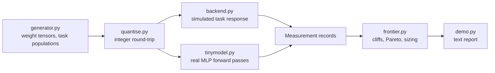

# quantfrontier

A quantisation quality/latency frontier measured on downstream tasks, because perplexity hides the cliff.

[](https://github.com/SlateGitOrg/quantfrontier/actions/workflows/ci.yml)

## Why

A team needs a model to run on hardware they already own. They pick a quantisation level from a forum post and find the output subtly worse in ways perplexity does not capture. Perplexity degrades smoothly, while task performance often falls off a cliff at a specific bit width, and the cliff sits in a different place for summarisation than for structured extraction. quantfrontier measures quality per task, finds the cliff, and reports a Pareto frontier of quality against latency and memory.

> **Scope.** No LLM, llama.cpp, GPU or model weights are used or required. Quantisation (int2-int16, per-tensor vs per-channel, symmetric vs asymmetric, fp outlier retention) is real integer arithmetic in pure Python. It runs on (a) a tiny 16-48-10 MLP with planted outlier rows, where accuracy, KL divergence and perplexity come from actual forward passes, and (b) a seeded simulated backend (`src/backend.py`) that maps *measured* weight error to per-task accuracy, latency and memory for a notional 7B deployment. None of the numbers below are real-LLM benchmark results. A real model plugs in by implementing `forward -> logits` and returning the same `Measurement` records; the frontier, cliff and sizing code is unchanged.

## Features

- Quantisation sweep across bit widths and methods (per-tensor, per-channel, symmetric, asymmetric, outlier retention)
- Per-task scoring, never a single aggregate number
- Cliff detection: largest single-step drop as a share of the total drop
- Output-distribution divergence (KL against full precision) as an early-warning signal
- Latency and memory with replication variance reported
- Per-task Pareto frontiers over quality, latency and memory, with a recommendation per constraint
- Eval-set sizing: how many items are needed to tell two adjacent configs apart

## Architecture



Synthetic tensors are quantised with a real integer grid. The measured reconstruction error drives either the simulated backend or the tiny MLP, both of which emit `Measurement` records. `frontier.py` consumes those records and is backend-agnostic. See [docs/ARCHITECTURE.md](docs/ARCHITECTURE.md).

## Quick start

Requires Python 3.11+. The code uses only the standard library, so there is nothing to install.

```bash
git clone https://github.com/SlateGitOrg/quantfrontier.git
cd quantfrontier
python -m src.demo                        # full report, about 7 s
python -m unittest discover -s tests -v   # 29 tests
```

## Example output

From `python -m src.demo` (deterministic seeds, trimmed):

```text
  Rule: 'smallest model whose aggregate quality stays above 0.80'
  Picks: q4-chan-sym  (perplexity 9.51, only 18.9% above full precision)

  What that config actually does on each task:
    json_schema_valid        0.023  <- BROKEN
    multistep_arithmetic     0.462  <- BROKEN
    longctx_retrieval        0.763
    summarisation_rouge      0.889
```

## How it works

- **Quantiser:** uniform integer quantisation with configurable bits, granularity, symmetry and outlier retention. Measured RMS error / (step/sqrt 12) is 0.998-1.000 for 3-8 bits, matching the closed form.
- **Cliff detection:** `degradation_profile` reports `cliff_share` (a smooth five-step curve gives 0.2, a cliff approaches 1.0) and the fewest steps that explain 90% of the total drop.
- **Pareto frontier:** computed per task, so the best configuration can differ between tasks.
- **Sizing:** a two-proportion test (alpha 0.05, power 0.80) gives the items needed per config.
- **Replication:** the report carries replication counts and standard errors with latency figures.

## Measured results

From `python -m src.demo`, deterministic seeds, about 7 s. The suite has 29 tests.

**Real forward passes (tiny MLP, 1600 eval items):**

| config | ppl | KL (nats) | classification | 8-field record |
|---|---|---|---|---|
| fp16 | 7.18 | 0.000 | 0.944 | 0.660 |
| q8 per-channel | 7.32 | 0.011 | 0.927 | 0.590 |
| q6 per-channel | 8.90 | 0.236 | 0.861 | 0.305 |
| q4 per-channel | 10.9 | 0.489 | 0.799 | 0.135 |
| q3 per-channel | 26.5 | 1.296 | 0.714 | 0.060 |
| q4 **per-tensor** | 9.6e3 | 8.883 | 0.158 | 0.000 |

- **Harness validation:** the full-precision scores match their planted expectations. Classification is 0.944 against 0.950, and the 8-field record is 0.660 against 0.95^8 = 0.663. Both are within 3 binomial standard errors.
- **Different fates per task:** at q4, classification keeps 85% of its full-precision score but the structured record keeps only 20%. An aggregate hides this.
- **Per-tensor vs per-channel:** with planted outlier rows, per-tensor q4 falls to near chance (0.158), while per-channel q4 scores 0.799.
- **Pure-Python quantiser:** measured RMS error / (step/sqrt 12) = 0.998-1.000 for 3-8 bits.

**Simulated backend (per-task frontier logic):**
- **Aggregate pick:** the rule "cheapest config with aggregate quality >= 0.80" picks q4-chan. At that config perplexity is +18.9%, but json_schema_valid accuracy is 0.023 (97.7% lost) and multistep arithmetic is 0.462.
- **Where the cliff sits:** one step (q5 -> q4) explains more than 90% of json_schema_valid's total drop. The aggregate needs 4 of 5 steps to reach 90%. The per-task pick at a 0.95 bar is q5, one bit wider than the aggregate pick.
- **Pareto frontiers:** 4 distinct frontiers across 5 objectives.
- **Eval-set size:** telling 0.90 from 0.85 needs n >= 686 items per config.

## Testing

```bash
python -m unittest discover -s tests -v
```

Tests cover the quantiser (round-trip error against the closed form, outlier handling), the tiny MLP (full-precision scores against planted expectations, within binomial error), and the frontier logic (cliff detection, Pareto dominance, sizing). Latency is reported but never asserted, since wall-clock numbers are noisy.

## Project layout

```text
src/
  quantise.py    integer quantiser
  generator.py   synthetic tensors and task populations
  backend.py     seeded simulated backend, Measurement records
  tinymodel.py   tiny MLP with real forward passes
  frontier.py    cliffs, Pareto frontiers, eval sizing
  demo.py        text report
tests/           unit tests
docs/            architecture notes
```

## Limitations

- **Simulated task cliffs:** the cliff in the simulated backend comes from planted per-item margins. The measurement code detects it; it does not prove LLMs behave this way. The real tiny-MLP results show per-task divergence, but not a sharp 5-bit vs 4-bit cliff.
- **Non-monotone curve:** on the tiny MLP, perplexity and KL are *not* monotone in bit width. q5 (KL 0.552) is worse than q4 (KL 0.489) at this seed. A single seed and a tiny model are noisy, so fewer bits is not guaranteed to be worse.
- **Latency:** tiny-MLP latency is wall-clock on dequantised floats. It does not reflect integer-kernel speed and is reported only. Simulated latency and memory use a stated cost model, not target hardware.
- **Not implemented:** no lm-eval-harness, DuckDB or Quarto. The frontier is text output, not a chart.
- Not a quantisation method. It measures existing ones.

## License

MIT — see [LICENSE](LICENSE).
