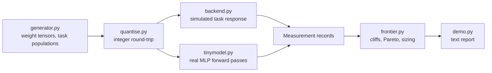

# Architecture

## Context

Teams that run a model on hardware they already own have to pick a quantisation
level. Perplexity is the usual yardstick, but it degrades smoothly while
individual tasks (structured JSON output, multi-step arithmetic) can collapse at
one specific bit width. quantfrontier measures that per task and reports the
trade-off between quality, latency and memory as a Pareto frontier.

## Container view

Everything downstream of `Measurement` is backend-agnostic. A real runtime
(for example llama.cpp logits per GGUF quant) can replace `ModelBackend` as long
as it returns the same records.

## Key decisions

- **Per-task frontiers, not one aggregate.** The best configuration differs by
  task. `frontier.pareto_frontier` is computed per task over (quality, latency,
  memory), and `recommend` picks per constraint.
- **Cliff share as the cliff signal.** `degradation_profile` reports the largest
  single-step drop divided by the total drop. A smooth curve over five steps
  gives 0.2; a cliff gives close to 1.0.
- **Real quantiser, simulated task response.** `quantise.py` does real integer
  arithmetic and its error is measured. The map from weight error to task
  accuracy in `backend.py` is a seeded simulation, so the demo is deterministic
  and needs no weights or GPU.
- **Real forward passes on a tiny MLP.** `tinymodel.py` supplies measured
  accuracy, KL divergence and perplexity with planted ground truth (known label
  noise) so full-precision scores have a closed-form expectation.
- **Eval-set sizing.** `min_eval_size` uses a two-proportion test (alpha 0.05,
  power 0.80) so a frontier is never drawn from differences smaller than the
  noise.
- **Replicated latency.** Latency is a mean and standard error over repeated
  runs; a difference is believed only if it clears the stated number of standard
  errors.

## Failure modes

- A single-run measurement carries no variance, so the report states the
  replication count next to every latency figure.
- Near-tied configurations produce very large required eval sizes; these are
  shown (or capped as `>10^6`) rather than hidden.
- Perplexity and KL on the tiny MLP are not monotone in bit width at a single
  seed, which the README calls out.

## Out of scope

- Implementing a quantisation method; this measures existing ones.
- Real LLM benchmarks, lm-eval-harness, charts. The frontier is text output.
